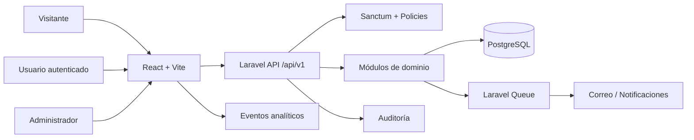

# Arquitectura técnica — Fase 1

## 1. Alcance

Esta fase define la arquitectura, el modelo de datos, los límites de los módulos
y el contrato inicial de la API. No implementa persistencia, autenticación,
autorización ni endpoints funcionales.

La solución se organiza como monorepo:

```text
/
├── backend/       Laravel 12, PHP 8.3+, PostgreSQL
├── frontend/      React, TypeScript, Vite
└── docs/          arquitectura y contratos
```

## 2. Arquitectura backend

Laravel se organizará por módulos de negocio. Cada módulo es dueño de sus
casos de uso, validaciones, recursos, políticas, rutas y pruebas.

```text
backend/app/
├── Modules/
│   ├── Auth/
│   ├── Users/
│   ├── Products/
│   ├── Categories/
│   ├── Services/
│   ├── Quotes/
│   ├── Contact/
│   ├── Notifications/
│   ├── Analytics/
│   └── Administration/
└── Shared/
    ├── Exceptions/
    ├── Http/
    ├── Rules/
    ├── Support/
    └── ValueObjects/
```

La plantilla de cada módulo será:

```text
<Module>/
├── Models/
├── Controllers/
├── Requests/
├── Resources/
├── Services/
├── Policies/
├── Events/
├── Listeners/
├── Jobs/
├── Routes/
└── Tests/
```

`Shared` solo contiene capacidades transversales estables. No debe convertirse
en un cajón para lógica específica de un módulo. Los módulos se comunican
mediante servicios públicos, eventos de dominio y contratos; no acceden a las
tablas internas de otro módulo directamente.

### Convenciones backend

- Laravel 13 sobre PHP 8.3+.
- PostgreSQL como base de datos principal.
- Form Requests para toda entrada externa.
- API Resources para respuestas estables y sin exponer modelos directamente.
- Policies/Gates en servidor para toda operación protegida.
- Jobs para correo, notificaciones, imágenes y analítica no crítica.
- Events/Listeners para desacoplar efectos secundarios.
- Todas las fechas en UTC; presentación localizada a `America/Bogota`.
- IDs `bigint` autoincrementales inicialmente; UUID solo si un caso de integración
  lo justifica.

## 3. Arquitectura frontend

```text
frontend/src/
├── components/    componentes reutilizables sin lógica de dominio
├── layouts/       shells y navegación
├── pages/         composición por ruta
├── features/      casos de uso por dominio
├── hooks/         hooks reutilizables
├── services/      orquestación de casos de uso del cliente
├── api/           cliente HTTP, contratos y adaptadores
├── store/         estado global mínimo
├── types/         tipos compartidos del cliente
├── utils/         utilidades puras
├── validation/    esquemas de validación de formularios
├── assets/        imágenes y recursos versionados
└── routes/        definición y protección de rutas
```

Las páginas componen features; los componentes no contienen reglas de negocio.
El cliente no almacena secretos. Los estados de carga, error, vacío, éxito y
offline deben representarse en cada flujo que consuma API.

## 4. Diagrama conceptual



## 5. Modelo de datos inicial

Todas las tablas deben incluir `created_at` y `updated_at`. Las tablas marcadas
con soft delete incluyen `deleted_at` e índice asociado.

### Identidad y autorización

- `users`: `id`, `name`, `email` unique, `password`, `phone`, `is_active`,
  `email_verified_at`, timestamps, `deleted_at`.
- `roles`: `id`, `name` unique, `slug` unique, `description`, timestamps.
- `permissions`: `id`, `name` unique, `slug` unique, `description`, timestamps.
- `role_user`: `role_id`, `user_id`, primary key compuesta y foreign keys cascade.
- `permission_role`: `permission_id`, `role_id`, primary key compuesta y foreign keys cascade.
- `personal_access_tokens`: tabla estándar de Sanctum, índice `(tokenable_type, tokenable_id)`.

Relaciones: `User` belongsToMany `Role`; `Role` belongsToMany `Permission`.

### Catálogo

- `categories`: `id`, `parent_id` nullable self-reference, `name`, `slug` unique,
  `description`, `is_active`, `sort_order`, timestamps, `deleted_at`.
- `products`: `id`, `category_id`, `name`, `slug` unique, `sku` nullable unique,
  `short_description`, `description`, `is_active`, timestamps, `deleted_at`.
- `product_images`: `id`, `product_id`, `path`, `alt_text`, `sort_order`,
  `is_primary`, timestamps, `deleted_at`.
- `product_specifications`: `id`, `product_id`, `name`, `value`, `unit` nullable,
  `sort_order`, timestamps.

Relaciones: `Category` hasMany `Product` y puede tener `parent`/`children`;
`Product` belongsTo `Category`, hasMany `ProductImage` y `ProductSpecification`.
Índices: `products(category_id, is_active)`, `categories(parent_id, is_active)`,
`product_images(product_id, sort_order)`.

### Servicios y cotizaciones

- `services`: `id`, `name`, `slug` unique, `description`, `is_active`, `sort_order`,
  timestamps, `deleted_at`.
- `quotes`: `id`, `public_reference` unique, `user_id` nullable, `company_name`,
  `contact_name`, `email`, `phone`, `message`, `status`, `source_ip` nullable,
  timestamps, `deleted_at`.
- `quote_items`: `id`, `quote_id`, `product_id` nullable, `description`, `quantity`,
  `notes` nullable, timestamps.

Foreign keys: `quotes.user_id` nullable `nullOnDelete`; `quote_items.quote_id`
cascade; `quote_items.product_id` nullable `nullOnDelete`. Índices:
`quotes(status, created_at)`, `quotes(email)`, `quote_items(quote_id)`.
`status` se restringe en aplicación a `pending`, `reviewing`, `quoted`,
`accepted`, `rejected`, `cancelled`.

### Contenido y comunicación

- `contact_messages`: `id`, `name`, `company_name` nullable, `email`, `phone`
  nullable, `subject`, `message`, `status`, `consent_at`, timestamps, `deleted_at`.
- `faqs`: `id`, `question`, `answer`, `sort_order`, `is_published`, timestamps,
  `deleted_at`.
- `testimonials`: `id`, `author_name`, `company_name` nullable, `content`,
  `is_published`, `sort_order`, timestamps, `deleted_at`.
- `blog_posts`: `id`, `author_id`, `title`, `slug` unique, `excerpt` nullable,
  `body`, `status`, `published_at` nullable, timestamps, `deleted_at`.

Foreign key: `blog_posts.author_id` `nullOnDelete`. Índices:
`contact_messages(status, created_at)`, `blog_posts(status, published_at)`.

### Notificaciones, analítica y auditoría

- `notifications`: tabla estándar Laravel, con `notifiable_type`,
  `notifiable_id`, `type`, `data`, `read_at`, timestamps e índice polimórfico.
- `analytics_events`: `id`, `name`, `user_id` nullable, `session_id` nullable,
  `path` nullable, `properties` JSONB, `occurred_at`, timestamps.
- `audit_logs`: `id`, `user_id` nullable, `action`, `auditable_type`,
  `auditable_id` nullable, `before` JSONB nullable, `after` JSONB nullable,
  `ip_address` nullable, `user_agent` nullable, `created_at`.

Índices: `analytics_events(name, occurred_at)`,
`analytics_events(user_id, occurred_at)`, `audit_logs(auditable_type,
auditable_id)`, `audit_logs(user_id, created_at)`. Los datos de auditoría son
append-only para usuarios de la aplicación.

## 6. API inicial versionada

Prefijo: `/api/v1`. Las respuestas usarán `{ data, meta, errors }` según el caso.
Los listados soportarán `page`, `per_page`, `sort` y filtros explícitos.

### Públicos

| Método | Ruta | Propósito |
|---|---|---|
| GET | `/categories` | Listar categorías publicadas |
| GET | `/categories/{category}` | Consultar categoría y productos |
| GET | `/products` | Buscar y paginar productos |
| GET | `/products/{product}` | Consultar ficha pública |
| GET | `/services` | Listar servicios publicados |
| GET | `/services/{service}` | Consultar servicio |
| GET | `/faqs` | Listar FAQ publicada |
| GET | `/testimonials` | Listar testimonios publicados |
| GET | `/blog-posts` | Listar artículos publicados |
| GET | `/blog-posts/{post}` | Consultar artículo |
| POST | `/quotes` | Crear solicitud de cotización |
| POST | `/contact-messages` | Crear mensaje de contacto |

### Autenticación y usuario

| Método | Ruta | Propósito |
|---|---|---|
| POST | `/auth/register` | Registrar usuario, sujeto a política |
| POST | `/auth/login` | Crear sesión/token Sanctum |
| POST | `/auth/logout` | Revocar sesión actual |
| GET | `/auth/me` | Obtener usuario autenticado |
| PATCH | `/users/me` | Actualizar perfil propio |

### Administración protegida

| Método | Ruta | Propósito |
|---|---|---|
| GET/POST | `/admin/products` | Gestionar productos |
| GET/PATCH/DELETE | `/admin/products/{product}` | Gestionar producto |
| GET/POST | `/admin/categories` | Gestionar categorías |
| GET/PATCH/DELETE | `/admin/categories/{category}` | Gestionar categoría |
| GET/PATCH | `/admin/quotes/{quote}` | Revisar y actualizar cotización |
| GET/PATCH | `/admin/contact-messages/{message}` | Gestionar contacto |
| GET/POST | `/admin/users` | Gestionar usuarios |
| GET/POST/PATCH/DELETE | `/admin/roles` | Gestionar roles y permisos |
| GET | `/admin/audit-logs` | Consultar auditoría |

## 7. Autenticación y permisos

Sanctum usará cookies HttpOnly y protección CSRF para el frontend web
first-party. Los tokens personales se reservarán para integraciones y se
mostrarán una sola vez. Contraseñas con el hasher estándar de Laravel,
verificación de correo, rate limit para login y recuperación de contraseña.

La autorización combinará permisos granulares (`products.view`,
`products.manage`, `quotes.review`, etc.) agrupados en roles. Roles iniciales
propuestos: `super-admin`, `content-manager`, `sales-agent`, `customer`.
Cada endpoint administrativo tendrá middleware de autenticación y una Policy;
ocultar botones en React nunca sustituye la comprobación backend.

## 8. Seguridad y operación

- Secretos solo en variables de entorno; nunca en Git ni en el bundle frontend.
- Validación, normalización y límites de tamaño en backend.
- Protección contra mass assignment mediante `$fillable` o DTOs.
- CORS con allowlist; HTTPS obligatorio en producción; cookies `Secure`,
  `HttpOnly`, `SameSite` apropiado.
- Rate limiting para autenticación, contacto y cotizaciones.
- Sanitización de contenido enriquecido y escape por defecto.
- Logs sin contraseñas, tokens ni datos innecesarios de contacto.
- Auditoría de cambios administrativos y retención definida por negocio.
- Backups cifrados de PostgreSQL y prueba periódica de restauración.
- Headers CSP, HSTS, `X-Content-Type-Options` y `Referrer-Policy`.
- Cola para notificaciones y reintentos con backoff; errores reportados,
  nunca convertidos en respuestas exitosas.
- Analytics con consentimiento cuando aplique y sin PII innecesaria.

## 9. Criterios de salida de Fase 1

- Estructura de carpetas creada sin lógica de negocio.
- Modelo de datos y límites de módulos aprobados.
- Contrato inicial de API revisado antes de escribir controladores.
- Entorno PHP/OpenSSL/Composer disponible para inicializar Laravel en la fase 2.
